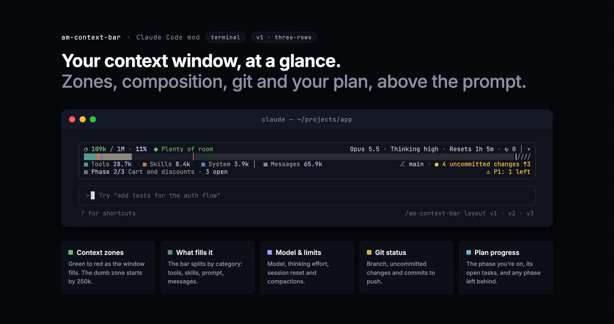
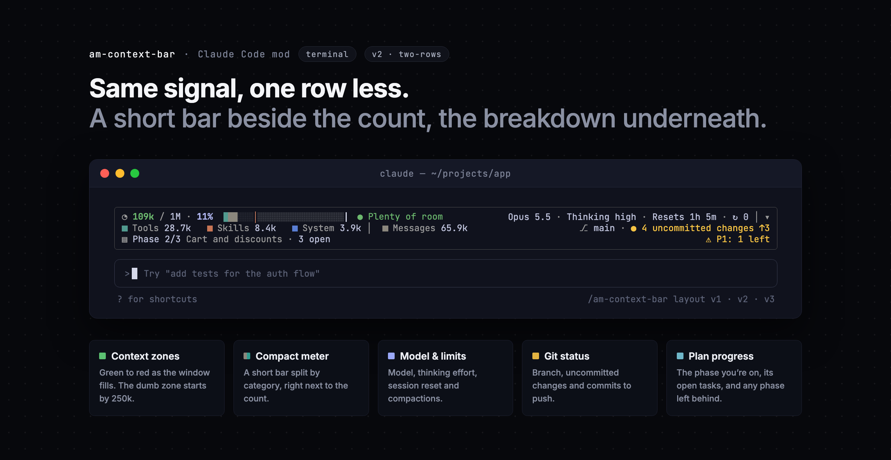
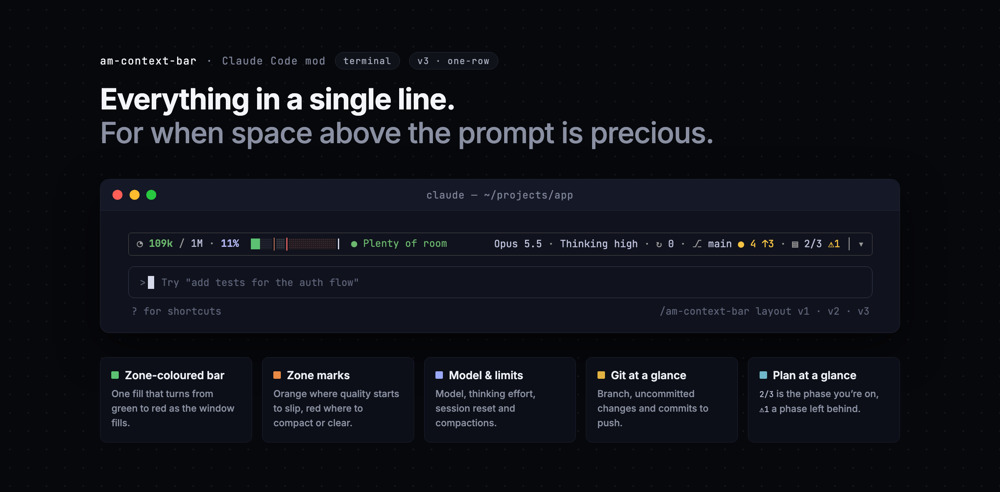
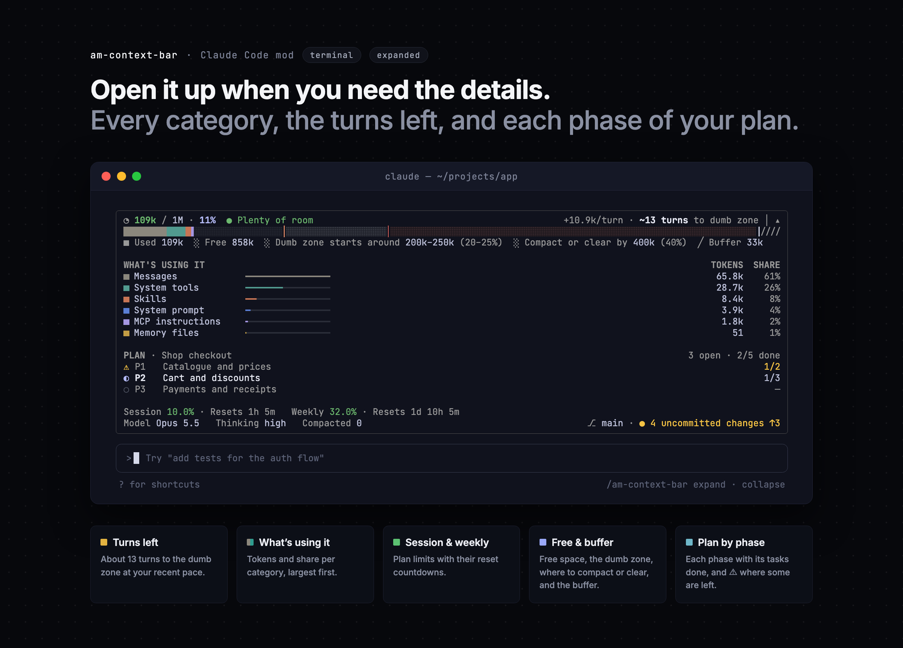
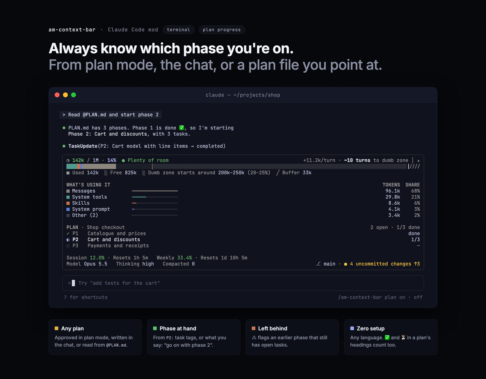

<div align="center">

# claude-am-mods

**Live UI mods for the [Claude Code](https://claude.com/claude-code) terminal.**

[](mods/am-context-bar/.claude-plugin/plugin.json)
[](LICENSE)
[](https://claude.com/claude-code)



</div>

---

## Mods

| Mod | What it does | Command |
| --- | --- | --- |
| [**am-context-bar**](#am-context-bar) | A card above the prompt that shows how full the context window is, what is filling it, how many turns you have left before quality drops, how far along a plan you are, your plan limits, and your git status. | `/am-context-bar` |

---

## am-context-bar

Long sessions slow down and get worse well before the context window is full. **am-context-bar** keeps that in view: a small card that sits above the prompt and updates after every turn. You can keep it collapsed to a line or two, or expand it for the full breakdown.

### At a glance

- **How full the context is**: tokens used out of the window, and the percentage, coloured by zone (green, yellow, orange, red).
- **The dumb zone**: the bar marks where the dumb zone starts (where answers tend to get worse: 50% of the window, or 250k tokens on large windows), where it's time to compact or `/clear` (70%, or 400k tokens), and where auto-compact kicks in.
- **What's filling it**: tools, MCP servers, skills, the system prompt, memory files and your messages, each in its own colour.
- **Runway**: how many tokens each turn adds and how many turns that leaves before the next mark.
- **Plan limits**: session and weekly usage, and when they reset.
- **Session details**: the model, the thinking effort, and how many times the session has been compacted.
- **Git**: the branch, uncommitted changes, and commits to push or pull.
- **Plan progress**: for a plan with phases, approved in plan mode, written in the chat, or read from a file or doc, which phase you're on, how many tasks are open, and any earlier phase left with tasks unfinished. No setup needed.
- **Fits in**: three collapsed layouts, theme colours that follow light and dark themes, and your terminal's own background.

### Requirements

- **Claude Code 2.1.289 or later**, in the terminal.
- **A Claude subscription** for the session and weekly limits. With an API key the card still works but has no limits to show.
- **git** on your `PATH` for the git status. Outside a repository the card reads *No git repo*.

### Install

At the Claude Code prompt:

```
/plugin install am-context-bar --marketplace romnycristopher/claude-am-mods
```

Answer `y` to add the marketplace, then pick a scope. User scope turns it on in every session.

Or from a shell:

```sh
claude plugin install am-context-bar --marketplace romnycristopher/claude-am-mods
```

The card starts hidden. Run **`/am-context-bar`** once to show it. It stays on in later sessions until you turn it off.

---

### The collapsed card

The collapsed card is the everyday view. It comes in three layouts, so you can trade detail for space.

#### V1 · three rows (default)


A full-width bar split by category, with a legend underneath.

#### V2 · two rows



A short bar beside the count, with the same legend.

#### V3 · one row



Everything on one line. The bar is a single fill in the zone's colour, so it turns from green to red as the window fills, and the git status shrinks to the branch and a mark.

#### Reading it

| Part | Meaning |
| --- | --- |
| `109k / 1M · 11%` | Tokens in context, the window size and the percentage used. The count takes the zone's colour. |
| `● Plenty of room` | The current [zone](#zones). |
| Bar | The context window. `│` in orange is where the dumb zone starts, `│` in red is where to compact or `/clear`, `│` in the text colour is auto-compact, and `╱╱` is the reserved buffer after it. |
| Legend | What's using the context. **MCP** combines MCP tools and MCP instructions, **System** combines the system prompt and memory files, and parts under 3% are left out of the legend (they stay in the bar). **Messages**, the part that grows as you talk, always comes last, after a `│`. |
| `Opus 5.5 · Thinking high` | The model, and the thinking effort the last request was sent with (`default` until the first one). |
| `Resets 1h 5m` | When the session limit resets. |
| `↻ 0` | How many times this session has been compacted. |
| `⎇ main · ● 4 uncommitted changes ↑3` | The branch, then `● 4 uncommitted changes` (staged, unstaged and untracked) or `✓ Nothing to commit` on a clean tree. `↑3` counts commits to push and `↓1` commits to pull, when the branch has an upstream. |
| `▤ Phase 2/3 Cart and discounts · 3 open` | With a plan, the phase you're on and its open tasks; `⚠ P1: 1 left` on the right flags an earlier phase with tasks still open. In V3 it shrinks to `▤ 2/3 ⚠1`. See [Plan progress](#plan-progress). |
| `│ ▾` | Expands the card. |

---

### The expanded card

Press **`▾`** (or run `/am-context-bar expand`) for the full picture. Press **`▴`** to collapse it again.



From top to bottom:

1. **Count and runway.** The runway is the average a turn added over the last five turns, and how many turns like that are left before the next mark: the dumb zone, then where to compact or clear, then auto-compact. Until a turn has been measured, it shows the tokens left to the next mark instead (`391k to dumb zone`). It starts over after a compaction or a `/clear`.
2. **The bar**, split by category, with the dumb zone shaded orange, the stretch past where to compact or clear shaded red, and auto-compact marked.
3. **The legend**: tokens used, free space, where the dumb zone starts (a range just below it, since quality tails off rather than dropping at one point: `200k–250k (20–25%)` on a 1M window), where to compact or clear (`400k (40%)`), and the buffer reserved for auto-compact.
4. **What's using it**: every category, largest first, with a bar relative to the largest, its tokens and its share of what's used.
5. **Limits**: session (five-hour) and weekly usage, green below 50%, yellow from 50%, orange from 80% and red from 95%, with their reset times.
6. **Session**: the model, the thinking effort and the number of compactions, with the git status at the right.

7. **Plan**, when there is one: a row per phase. See [Plan progress](#plan-progress).

The expanded card fits the space above the prompt instead of scrolling. On a short terminal it drops its blank spacer lines first, then the blank line above the card, then shrinks the plan to its one-line summary, then folds the smallest categories into one **Other** row.

---

### Plan progress

Long plans get split into phases, and halfway through it's easy to lose track of how many are left, or to move on with a point of an earlier phase still open. When Claude gives you a plan with phases, approved in plan mode, written in the chat, or read from a file or doc, the card follows it.



**Collapsed**, one more line:

```
▤ Phase 2/3 Rules in PHP · 3 open                      ⚠ P1: 1 left
```

The phase you're on, out of how many; the tasks still open; and, on the right, any earlier phase left with tasks unfinished. In the one-row layout it shrinks to `▤ 2/3 ⚠1`. When every task is done it reads `✓ Plan done`.

**Expanded**, a row per phase:

```
PLAN · From the plugin to the API                    3 open · 1/4 done
⚠ P1   Fix the plugin before the cutover                          1/2
◐ P2   Rules in PHP                                               0/2
○ P3   API, notifications and app                                   —
```

`✓` done, `◐` in progress, `○` not started (`—` when Claude hasn't made its tasks yet), `⚠` an earlier phase with tasks still open.

With no tasks, a phase shows `now` or `done` instead of a count, and the collapsed line reads `▤ Phase 2/3 Implement · in progress`, or `up next` once the phase before is done.

#### How it works

It works on its own, with nothing to add to your `CLAUDE.md`:

1. **The phases come from the plan.** When you approve a plan, the card reads its headings. A plan Claude writes in its answer instead of plan mode counts too, when two or more of its headings name phases (`## Phase 1: …`, `## Fase 2 — …`). An answer with numbered headings alone isn't taken for a plan. So does a plan Claude reads: a file you name with `@` (`lee @PLAN.md completo`), a file it opens (`Read`, `cat`), or a doc another tool fetches. With no plan on the card yet, any document with two or more phase headings is taken as the plan. Once the card follows one, another document replaces it only when your prompt asked Claude to read something (`lee este documento completo`, `read the roadmap`, `@notes.md`), or the document calls itself a plan, in its file name (`PLAN.md`) or its title (`# Plan: …`); a file with phases Claude opens on its own, for something else, leaves the card alone. The card takes the whole file, even when Claude read only one page of it. It finds phases in any language (`## Phase 1`, `## Fase 2 — …`, `## Étape 3`, `## Stage B`, `## Milestone 1`…), or, when no heading names a phase, numbered headings (`## 1. …`, `## 2. …`). A plan with fewer than two phases isn't tracked.
2. **The tasks come from Claude's task list** (`TaskCreate` and `TaskUpdate`, or `TodoWrite`), as Claude creates and finishes them.
3. **A tag ties each task to its phase.** Claude starts each task with its phase tag, `P1:`, `P2:`, … (`P2.3:` for step 2.3). The card also accepts `F2:`, `Phase 2:`, `Fase 2:`, `§2:` and `[P2]`.
4. **Without tasks, the conversation tells the phase.** Not every session has the task tools, and small plans often go without tasks. Then the card goes by what's said. When you ask for a phase (`go on with phase 2`, `sigue con la fase 2`, `do P3`), that phase is in progress. When Claude or you say a phase is finished (`Phase 1 is done`, `La fase 2 está terminada`, `Étape 3 terminée`, `Phase 2 ✓`), it's done, and the card moves on to the next. The plan's own headings count too: one marked done (`## Fase 1 — Diseño ✅`, `(hecha)`, `(done)`) is done, and one marked at work (`## Fase 3 — Pruebas ⏳`, `(in progress)`, `(en curso)`) is in progress. Tasks win where a phase has them.

Claude knows about the tags because the mod tells it. This is everything the mod adds to what Claude reads:

- In the description of the `TaskCreate` and `TodoWrite` tools:
  > Phase tags: when the tasks carry out a plan split into phases (Phase 1, Fase 2, Stage A…), start each one with its phase tag, P\<phase\>: — for example "P2: Add the migration", or "P2.3: …" for step 2.3. The person's context card counts progress per phase from these tags.
- After you approve a plan with two or more phases, or Claude reads one, a note with that plan's tags:
  > This plan has 3 phases: P1 …; P2 …; P3 …. Start the subject of every task you create for it with its phase tag ("P1: …"), so the person's context card counts it under its phase. When you finish a phase, say so naming it ("Phase 1 is done"). If you move on while tasks of an earlier phase are still open, say so.

To follow the conversation, the card reads your prompts and Claude's answers as they happen. It only looks for phase names and done words, and adds nothing to what Claude reads.

If Claude leaves a task untagged, nothing is lost: it's counted as **Untagged** in the expanded card, and with no tags at all the card shows only the totals (`3 phases · 7/12 tasks done`).

A new plan replaces the last one, keeping the tasks that are still open. The same plan again (written in the chat, then approved) keeps what was already done. A `/clear` forgets it. A resumed session picks up where it was.

#### Plans kept in a file

To work from a plan you keep in a file or a doc, ask Claude to read it, in any words (`lee @PLAN.md completo`, `read the whole plan in docs/plan.md`); from then on the card follows it like an approved one, and Claude gets the same note with its tags. If you want Claude to tag tasks even when it isn't told about the plan, add this to your `CLAUDE.md`:

```markdown
## Tasks of a plan with phases
When you carry out a plan split into phases, start each task's subject with
its phase tag: `P1: …`, `P2: …` (`P2.3: …` for step 2.3).
```

#### Turning it off

`/am-context-bar plan off`, or **Plan progress** in `/config`. Off, the card tracks nothing and the mod adds nothing to Claude's tool descriptions or plans. `/am-context-bar plan on` brings it back.

---

### Zones

The count, the status pill and the V3 bar change colour with how full the window is:

| Zone | 200K window | 1M window | Colour |
| --- | --- | --- | --- |
| Plenty of room | under 35% (70k) | under 175k | green |
| Nearing dumb zone | 35–50% (70k–100k) | 175k–250k | yellow |
| Dumb zone | 50–70% (100k–140k) | 250k–400k | orange |
| Compact or clear | 70% and up (140k) | 400k and up | red |

Quality tails off with the tokens in context, not with how full the window is, so on large windows the dumb zone starts by 250k tokens at the latest, and the yellow mark keeps its distance below it. Nobody has an official number for this. Anthropic describes [context rot](https://www.anthropic.com/engineering/effective-context-engineering-for-ai-agents) as a gradient, not a cliff, and developers report the slide on 1M windows somewhere between 120k and 250k tokens. 250k is the late end of that range: lower it if you see it sooner, or set it to `0` to go by percentage alone.

Past the dumb zone answers keep sliding, and the red zone is where to stop and compact or `/clear` rather than wait for auto-compact, which on a large window comes far later. Developers put that point at 120k–150k tokens on 200K windows and around 400k–500k on 1M windows ([1](https://github.com/anthropics/claude-code/issues/34685), [2](https://github.com/anthropics/claude-code/issues/35296), [3](https://www.albertsikkema.com/ai/development/tools/2026/04/23/smaller-context-window-better-claude-code.html)), so it starts at the lower of 70% and 400k tokens. It's marked only when it comes before auto-compact.

All four colours come from your theme, so they stay readable in light and dark themes. The cut-offs are [settings](#settings).

### Commands

| Command | What it does |
| --- | --- |
| `/am-context-bar` | Shows or hides the card. |
| `/am-context-bar on` · `off` | Shows or hides it explicitly. |
| `/am-context-bar expand` · `collapse` | Opens the expanded or the collapsed view (and shows the card if it's hidden). |
| `/am-context-bar layout v1` · `v2` · `v3` | Picks the collapsed layout. Also accepts `three-rows`, `two-rows`, `one-row`. |
| `/am-context-bar plan on` · `off` | Turns [Plan progress](#plan-progress) on or off. |

Whether the card is shown and whether it's expanded are remembered across sessions. A `/clear` brings it back collapsed and starts the runway and the compaction count over.

### Settings

Change these in **`/config`**, under am-context-bar:

| Setting | Key | Default | What it does |
| --- | --- | --- | --- |
| Layout | `layout` | `three-rows` | The collapsed layout: `three-rows`, `two-rows` or `one-row`. The same setting `/am-context-bar layout` changes. |
| Nearing dumb zone at (%) | `nearingAt` | `35` | Where the count turns yellow. |
| Dumb zone starts at (%) | `dumbZoneAt` | `50` | Where the dumb zone starts: marked on the bar, and the count turns orange. |
| Dumb zone starts by (tokens) | `dumbZoneTokens` | `250000` | On large windows the dumb zone starts here at the latest, whatever the percentage. `0` turns it off. |
| Compact or clear at (%) | `compactNowAt` | `70` | Where it's time to compact or `/clear`: marked on the bar, and the count turns red. |
| Compact or clear by (tokens) | `compactNowTokens` | `400000` | On large windows it's time to compact or clear here at the latest, whatever the percentage. `0` turns it off. |
| Plan progress | `planProgress` | `true` | Follows the phases of a plan, approved or written in the chat, and asks Claude to tag tasks with their phase. |

The three cut-offs must go up in order (`nearingAt` < `dumbZoneAt` < `compactNowAt`). If they don't, the card falls back to the defaults.

You can also set them at install time:

```sh
claude plugin install am-context-bar --marketplace romnycristopher/claude-am-mods --config layout=two-rows --config dumbZoneAt=40
```

or in `settings.json`:

```json
{
  "pluginConfigs": {
    "am-context-bar@claude-am-mods": {
      "options": { "layout": "two-rows", "dumbZoneAt": 40 }
    }
  }
}
```

### Privacy

Everything stays on your machine. The card reads the session's own token usage and limits from Claude Code, runs `git rev-parse` and `git status` in the working directory, and, with Plan progress on, reads the plans Claude gives you or reads, Claude's task list, and your prompts and Claude's answers for the phases they name. It keeps the current plan in the plugin's local store so a resumed session gets it back. It makes no network requests and sends nothing anywhere.

---

## License

[MIT](LICENSE) © Romny Cristopher
